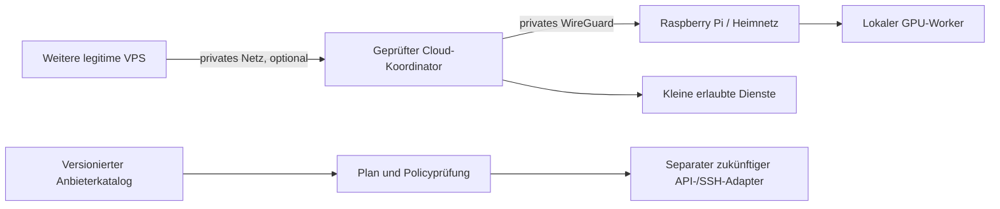

# Zusammenspiel mit OpenClaw, Automaton und Kubernetes

Geprüft am 18.11.2026 anhand öffentlicher Dateien des [Hauptprojekts](https://github.com/dwhr-pi/OpenClaw-AI_Infrastructure-_Ultimate_Setup/). Diese Ergänzung ändert das Hauptprojekt nicht und startet dort keine Runtime.

## Was Automaton heute kann

Der konkrete Automaton im Repository stammt von Conway Research. Das Setup bietet einen optionalen, gepinnten nativen Quellbuild. Der getrennte Python-Prüfer akzeptiert nur Offline-Vorschläge und gibt keine Ausführungsfreigabe. Das ist kein fertiger Multi-Cloud-Registrierungsdienst.

| Schritt | Geprüfter heutiger Stand | Sinnvoller Ausbau |
| --- | --- | --- |
| Anbieter recherchieren | Kein allgemeiner Providerkatalog-Adapter im gelesenen Automaton-Pfad | Diesen Katalog versioniert importieren und Quellen prüfen |
| Neues Cloudkonto erstellen | Kein implementierter universeller Signup; menschliche Identität/Vertrag fehlt | Nur belegte offizielle Onboardingwege unterstützen; sonst `human_action_required` |
| CAPTCHA, KYC, MFA, Karte | Kein Recht zur Umgehung | Vorgesehenen Menschen-/Providerprozess einhalten |
| VM über API anlegen | Setup-Provisionierung derzeit gesperrt | Separate Provideradapter mit Budget und belegter Autorisierung |
| VPS über SSH einrichten | Vorhandener Ansible-/nativer Setup-Pfad ist nutzbar, aber nicht als Automaton-Bridge implementiert | Feste, überprüfte Adapter mit Plan, Wiederaufnahme und Nachweis |
| Bestehende Cluster verbinden | Keine allgemeine getestete Automaton-Funktion | VPN-/Node-/Quotenprüfung, begrenzter Join-Adapter, Stagingtest |
| Mining/Live-Trading starten | Kein Nachweis einer Freigabe | Anbieterregeln und gesonderte Arbeitsaufträge beachten |

Belege: [Automaton-Dokumentation](https://github.com/dwhr-pi/OpenClaw-AI_Infrastructure-_Ultimate_Setup/blob/main/docs/tools/automaton.md), [Offline-Prüfer](https://github.com/dwhr-pi/OpenClaw-AI_Infrastructure-_Ultimate_Setup/blob/main/tools/automaton/review.py), [Build-Wrapper](https://github.com/dwhr-pi/OpenClaw-AI_Infrastructure-_Ultimate_Setup/blob/main/scripts/tools/helpers/automaton_common.sh), [Policy-Entwurf](https://github.com/dwhr-pi/OpenClaw-AI_Infrastructure-_Ultimate_Setup/blob/main/config/automaton.policy.example.json). Die Policy ist keine vom Upstream automatisch geladene Sandbox. Einzelne Schlüssel auf `true` zu setzen schafft weder einen Adapter noch sichere Ausführung.

Der [Codex-Prompt](../prompts/CODEX-OPENCLAW-VPS-de.md) beschreibt die Weiterentwicklung. Er trennt dokumentierte Fähigkeiten, implementierte Adapter und tatsächlich bestandene Laufzeittests. Die Wochenpflege aktualisiert ihn bei belegten Änderungen.

## Architektur für diese Ergänzung

Rechenleistung und GPU-Modelle bleiben vorzugsweise auf vorhandener lokaler Hardware. Ein Gratis-CPU-VPS ist Koordinator oder kleiner Dienst, keine versprochene kostenlose KI-Trainingsfarm. Native Builds, Updatepins, Datenhaltung und Wiederherstellung folgen der aktuellen Hauptprojekt-Richtlinie.

## Mehrere Konten sind nicht mehrere Kubernetes-Nodes

Für mehrere VMs reicht oft ein einziges legitimes Cloudkonto. Unterschiedliche rechtmäßige Personen/Organisationen oder verschiedene Anbieter können technisch private Nodes verbinden; jeder Vertrag und jede Quotengrenze gilt weiter. Oracle verbietet mehrere Free-Konten derselben Person ausdrücklich; Google untersagt Konto-/Projektaufteilung zum Gebühren-/Quotenumgehen, AWS die Vervielfachung der Free-Angebote und GreenCloud mehrere Konten. [Oracle FAQ](https://www.oracle.com/cloud/free/faq/), [Google-Vertrag](https://cloud.google.com/terms/), [AWS Free Tier Terms](https://aws.amazon.com/free/terms/), [GreenCloud ToS](https://greencloudvps.com/terms-of-service.php)

Andere Karten bleiben bei „ungeklärt“, bis eine belegte Regel vorliegt. Eine API für VMs beweist keine Erlaubnis für automatisierte neue Nutzerkonten. Keine falschen Identitäten, keine Ersatzaccounts nach Sperren und keine automatischen Communitybeiträge zum Erreichen einer Gratisquote.

## Warum viele winzige VPS kein gutes gemeinsames Cluster ergeben

Latenz, NAT, UDP-Sperren, fehlendes TUN/cgroups, wechselnde IPv6-Adressen und CPU-Fair-Share können einen Join verhindern. Über Anbietergrenzen entstehen Egresskosten und Ausfälle durch unterschiedliche Verlängerungsfristen. RAM und Disk werden nicht zu einem gemeinsamen großen Rechner addiert; ein Pod benötigt weiterhin einen passenden einzelnen Node.

Die Control Plane möglichst auf einem stabilen Standort halten. Gratis-/Trial-Nodes höchstens als verzichtbare Worker nach konkretem Test nutzen. Kein etcd-Quorum über unzuverlässige globale Mini-VPS, keine verteilte Datenbank oder Longhorn-Installation als Standard. Lokaler Speicher ist nicht hochverfügbar. Daten und Recovery-Keys unabhängig vom jeweiligen Gratisanbieter sichern.

Für einen kleinen Server sind Ansible plus systemd häufig einfacher als Kubernetes. Das ist eine Betriebswahl, kein automatischer Ersatz der vom Hauptprojekt vorgesehenen Installationswege.
